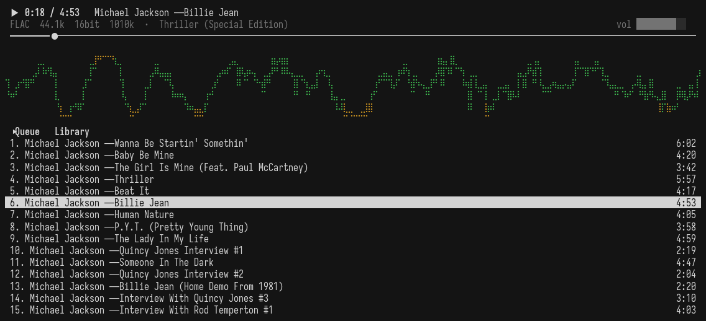
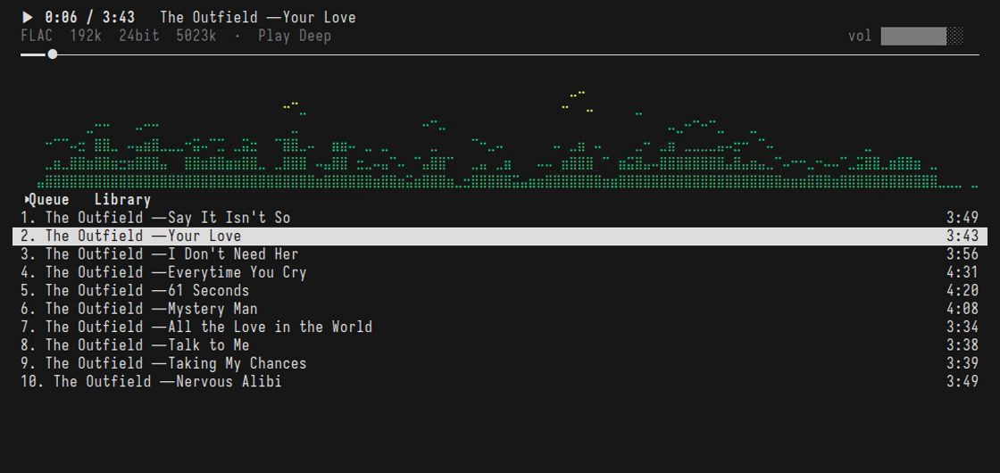
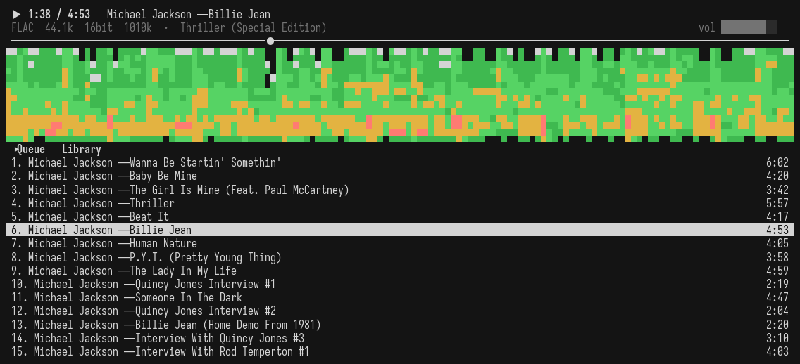
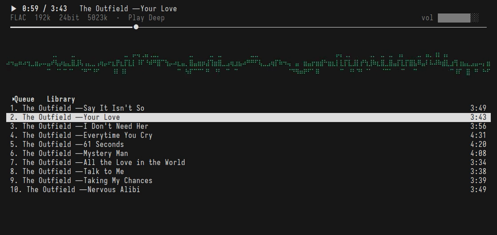
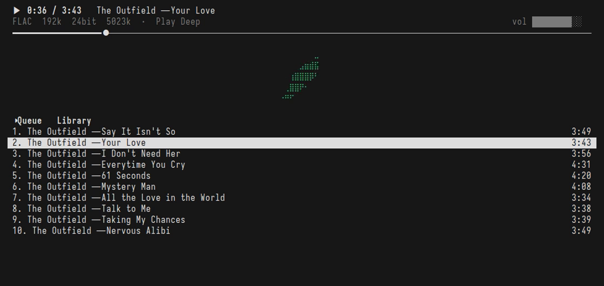
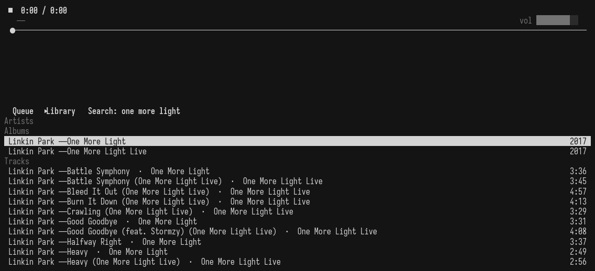

# dotamp

A terminal music player drawn in dots. Plays your Plex or Navidrome library, Winamp-shaped, with four visualizers drawn in braille, in any modern terminal.

[](https://ko-fi.com/bradycole)



| Spectrum bars | Spectrogram |
|---|---|
|  |  |
| **Oscilloscope** | **Stereo field** |
|  |  |

Search asks every server at once and groups what it finds:



## Install

Homebrew builds it locally, so there is no unsigned-binary warning:

    brew install brady1408/tap/dotamp

With Go:

    go install github.com/brady1408/dotamp/cmd/dotamp@latest

Or take a prebuilt binary from the [releases](https://github.com/brady1408/dotamp/releases). Those are unsigned for now: macOS wants a right-click → Open on first launch; on Windows, Chrome may flag the download (choose "Keep" in the downloads panel) and SmartScreen wants "More info → Run anyway" on first run. A fresh unsigned Go binary trips those heuristics; `go install` sidesteps both because the build is local.

## First run

    dotamp

The first run asks one question: Plex, Navidrome, or both. Plex sign-in is a link to approve in your browser; from then on dotamp finds your servers through your account, the LAN address at home, the public address when you're away, Plex's relay as a last resort. Navidrome is a URL, a username and a password, asked once. Then the player opens.

Later, the same steps are available as commands: `dotamp login`, `dotamp navidrome URL USER`, and `dotamp servers` to list every server and how each one is reached.

With both kinds of library configured, search covers all of them, the Servers entry in the Library menu switches the one you browse, and the queue can mix them.

## Use

Run `dotamp`. The deck on top shows the track, its album and format, the clock and the seek bar. The visualizer takes the middle. The bottom pane is Queue or Library.

| Key | Action |
|---|---|
| space | play / pause |
| `n` / `p` | next / previous track |
| ← / → | seek 5 s |
| `+` / `-` | volume |
| Tab | switch Queue / Library |
| `/` | search every server at once |
| Enter | open an artist, album or playlist; on a track, play its album or playlist from there |
| `a` | add the album, playlist or track to the queue |
| `w` | save the queue as a playlist |
| `t` | add the track, album or playlist to one of your playlists |
| `x` / `[` / `]` | in a playlist: remove the track / move it up / move it down |
| `e` / `d` | rename / delete the playlist (delete asks y/n) |
| `b` | broadcast to your Discord voice channel / stop |
| `x` / `c` | remove the selected track from the queue / clear the queue |
| Backspace | back |
| Esc | straight back to the Library menu |
| `A`–`Z`, `#` | jump to a letter in the artist index |
| `s` / `r` | shuffle / repeat |
| `v` | spectrum bars / oscilloscope / spectrogram / stereo field |
| `?` | help |
| `q` | quit |

The mouse works too: click the seek bar, double-click a row, scroll the lists.

The Library opens on a menu: **Artists** is every artist on the current server with letter jumps, **Recently added** the latest albums, **Playlists** every playlist on every server, each saved queue included, and **Servers** appears when more than one server with music is reachable, your Navidrome, your Plex, and any Plex shared with you. Search always asks all of them and groups the results by server, marking copies that live on a remote or relayed server. Every album row carries a quality tag on the right, `FLAC 16/44.1` or `MP3 320k`, read from its first track a moment after the list appears, so two copies of an album read apart before you play either. Playlists whose names match the search are listed too. `w` saves the queue as a playlist on the server its tracks live on; a queue that mixes servers makes one playlist per server with the same name, and the notice says what went where. Inside a playlist, `x` removes the selected track on the server and `[` / `]` move it; `t` on any track, album or playlist adds it to a playlist you pick; `e` renames and `d` deletes a playlist, from its row or from inside it.

FLAC and MP3 play as the original file, with gapless transitions between tracks. Any other format, ALAC, AAC, Ogg, WAV, is transcoded to MP3 320 by the server on the way, and the deck shows what arrived. A file that would not fit through Plex's relay is transcoded the same way. Native ALAC is the first decoder to add if people ask; AAC will stay with the server, since the only pure Go route is a cgo one.

Output is 32-bit float at one fixed device rate, 44.1 kHz unless `output_rate` says otherwise. Every file is converted to that rate once, through a windowed-sinc resampler that passes a tone within a fraction of a decibel and rejects aliasing by better than 40 dB. If your DAC runs at 48 or 96 kHz, set `output_rate` to match and nothing is converted twice.

## Discord

dotamp can play into the voice channel you are in, so the call hears your queue in stereo at full quality, end-to-end encrypted like any other Discord call. Join a voice channel and press `b`. Your own speakers go quiet while live and come back when you press `b` again; the visualizers keep moving. The bot follows you between channels and leaves when you do.

### Setting up your bot

Each person runs their own bot. Discord only lets a bot account join voice, and a bot account can be in one voice channel per server, so a shared bot would fight over itself. Making one is free and takes about five minutes:

1. Go to [discord.com/developers/applications](https://discord.com/developers/applications), click **New Application**, and name it (the name is what the voice channel shows, so "dotamp" or your own name both work).
2. Open the **Bot** tab and click **Reset Token**. Copy the token; Discord shows it once.
3. Save the token on one line in `~/.config/dotamp/discord-token`. Nothing else goes in that file, and it never goes in `config.json`.
4. Invite the bot to your server: **OAuth2** tab, **URL Generator**, tick the `bot` scope, then the permissions **View Channels**, **Connect** and **Speak**. Open the generated URL and pick the server. The bot needs no message permissions and no privileged intents.
5. Find your own user ID: in Discord, Settings → Advanced → **Developer Mode**, then right-click your name anywhere and **Copy User ID**.
6. Run `dotamp discord YOUR_USER_ID`. It saves the ID, checks the token logs in, and lists the servers the bot is in.

Now join a voice channel on one of those servers and press `b`. If several people in a server each have dotamp and their own bot, they can all broadcast at once, each bot following its owner.

The bot does nothing until you press `b`; dotamp runs normally with no Discord setup at all.

### Requests from the room

Set `"commands": true` in the `discord` block and the bot answers `/dotamp` with three subcommands in any server it is in, for people in the voice channel it is playing to:

- `/dotamp play <what>` adds a track, album or playlist from your library; autocomplete searches as they type. The reply is public so the room sees who added what.
- `/dotamp np` says what is playing and who asked for it.
- `/dotamp queue` lists what is coming, with names.

Requests are fair by construction: each person gets a lane, and the lanes take turns with your own queue, one song each. Forty requests from one person just fill that person's lane. `max_pending_per_user` caps a lane if you want one (0 = unlimited). Requested songs show the requester's name in the Queue tab, and a Requests section under the queue shows who is waiting. `c` clears the queue and every lane.

Every song played while broadcasting is logged under `~/.config/dotamp/history/`, one file per server. The Library's **Nights** menu turns a server's history into a queue of its most-played songs, recent nights weighing more and skips counting against. With `"save_nights": true` each broadcast is also saved as a playlist on your music server, named for the channel and date.

## Control

A running dotamp listens on localhost for JSON commands, and `dotamp ctl` speaks to it from another shell (or over ssh), so scripts and assistants can read the player and drive the queue:

| Command | Does |
|---|---|
| `dotamp ctl status` / `queue` / `requests` | what is playing, the queue with who asked, the request lanes |
| `dotamp ctl search "collective soul"` | tracks, albums and playlists with ids like `t:…`, `a:…`, `p:…` |
| `dotamp ctl album a:…` / `playlist p:…` | their tracks |
| `dotamp ctl play IDS` / `add [--as NAME] IDS` | replace the queue, or append; `--as` makes it a request under NAME |
| `dotamp ctl remove INDEX` / `clear` / `next` / `prev` / `pause` | the keys' equivalents |
| `dotamp ctl playlists` / `playlist-create NAME IDS` / `playlist-add p:… IDS` | playlists on your servers |

Ids may mix tracks, albums and playlists; albums and playlists expand to their tracks. Track ids come from a listing in the same dotamp run (`search`, `album`, `playlist`, `queue`). Replies are one line of JSON; exit status is 0 on success. The port and a random token live in `~/.config/dotamp/control.json` while dotamp runs, readable only by you, so only your own processes can talk to it. `"control": false` in the config turns it off.

## Visualizers

`v` cycles four views of what the speaker is playing right now, all drawn from the same audio tap thirty times a second, all taking their colours from your terminal's palette:

- **Bars**: a spectrum analyzer, one braille column per terminal column on a log frequency axis, with peak caps that hold and fall.
- **Oscilloscope**: the waveform as a line, triggered on a zero crossing so a steady tone holds still.
- **Spectrogram**: a waterfall scrolling left to right, frequency bottom to top, loudness as colour. Harmonics stack as lines, drums are vertical streaks, reverb fades to the right.
- **Stereo field**: left channel across, right channel up. Mono draws a diagonal, a wide mix fills a cloud, a channel out of phase leans the other way.

The one you leave it on is remembered.

## Config

`~/.config/dotamp/config.json` is written by the first run. Optional keys:

| Key | Meaning |
|---|---|
| `server_name` | which of the account's servers to browse by default; the first owned one otherwise |
| `remote_bitrate` | kbps to transcode to on any non-local connection, e.g. `192` to save mobile data; original when unset |
| `server`, `token` | a fixed server and token, which skip account discovery entirely |
| `navidrome` | `{"url", "user", "password"}` for a Subsonic server; written by the first run or `dotamp navidrome` |
| `visual` | the visualizer to start on: `bars`, `scope`, `spectrogram` or `stereo`; `v` updates it |
| `output_rate` | the sample rate the audio device is opened at; 44100 when unset. Set it to your DAC's rate (48000, 96000, …) so the OS does not resample a second time |

The log lives at `~/Library/Caches/dotamp/dotamp.log` on macOS and `~/.cache/dotamp/dotamp.log` elsewhere. `dotamp --debug` adds every HTTP request to it.

The keyboard's media keys, play/pause, next and previous, reach dotamp even when another window has focus. On Windows it registers them as global hotkeys at start, which takes them from other players while it runs. On Linux it registers as an MPRIS player on the session bus, so the desktop routes the keys to it and its media widget shows the track. On macOS it registers with Now Playing, so the keys, the Control Centre widget and the Touch Bar all drive it and show the track. Set `"disable_media_keys": true` in the config to opt out.

```json
"discord": {"user_id": "123456789012345678", "token_file": "~/.config/dotamp/discord-token",
            "commands": false, "max_pending_per_user": 0, "save_nights": false},
"control": true
```

`token_file` is optional and defaults to the path above. The token never goes into config.json.

`"scope_afterglow": true` keeps the oscilloscope's previous frame on screen a moment longer in a dim green under the live trace, the way a phosphor screen fades. Off by default; try both, opinions differ.

`dotamp --silent` runs without a sound device: nothing is heard, but the visualizers move exactly as they would over speakers. It is how the pictures above are made, and it lets dotamp run on a box with no audio.

## Terminals

Any terminal with truecolor, mouse reporting and a font that has braille: iTerm2, Ghostty, Kitty, WezTerm, Windows Terminal with Cascadia Mono. The analyzer's colours come from your terminal's palette.

The font decides how the visualizers look. Braille glyphs in some fonts carry padding above and below their dots, which turns a bar into a stack of bricks with a seam between every row of cells. Fonts whose dots reach the cell edges tile into solid shapes: **Iosevka** and **Cascadia Mono** do; Menlo has no braille at all and macOS substitutes a font that doesn't tile. In iTerm2, "Use a different font for non-ASCII text" lets you keep your text font and give only the dots to Iosevka; a vertical spacing around 85 closes any remaining seam. On a Retina display a bold weight at a larger size, Iosevka Bold at 16 for example, gives each dot more pixels and reads noticeably better than the regular weight. On Windows, WezTerm or Windows Terminal with Cascadia Mono needs no tuning.

On macOS 15 and later the terminal app needs Local Network access the first time (System Settings → Privacy & Security → Local Network). If you see `connect: no route to host` while `curl` to the same address works, grant it and relaunch the terminal; the permission is read at launch.

## Build

    make build      # this machine
    make mac        # darwin/arm64
    make windows    # windows/amd64
    make test
    make demo       # re-record the pictures in docs/ (needs tmux, asciinema, agg, ffmpeg, Iosevka)

Pure Go, no cgo, on every platform. Discord support uses disgo, dave-go (DAVE end-to-end encryption in pure Go) and gopus (Opus in pure Go); Go 1.27.

## License

MIT

## Support

dotamp is free and will stay that way. If it has become the thing you play music with, you can [buy the next round on Ko-fi](https://ko-fi.com/bradycole). Issues and pull requests are just as welcome.
